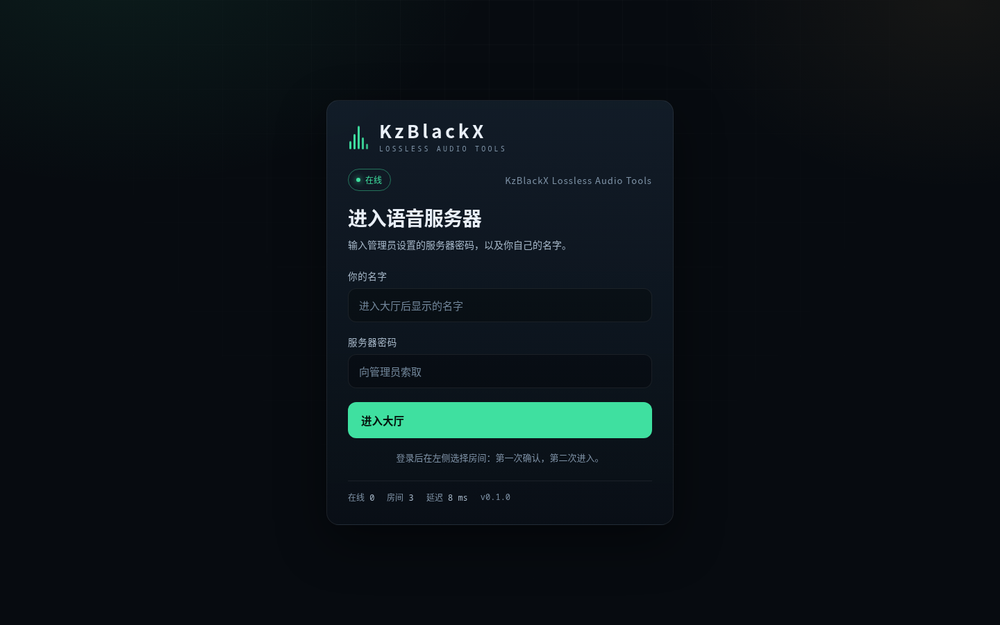
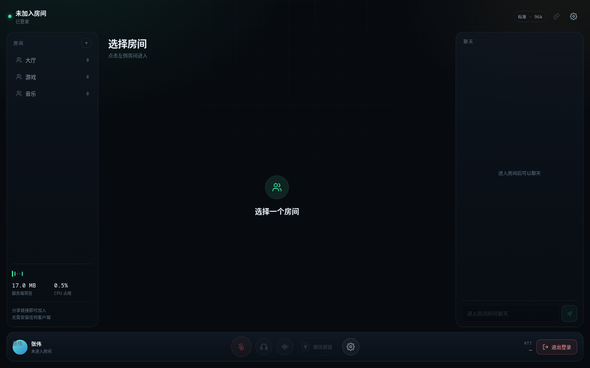
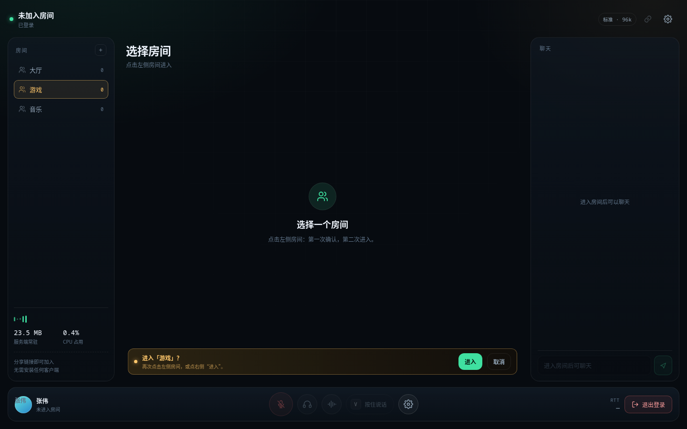
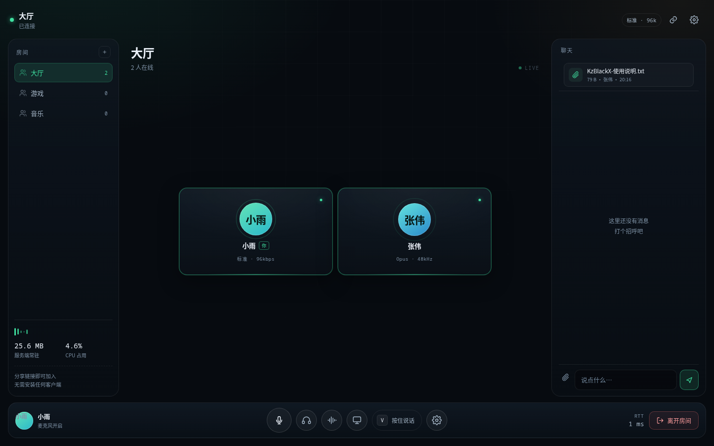
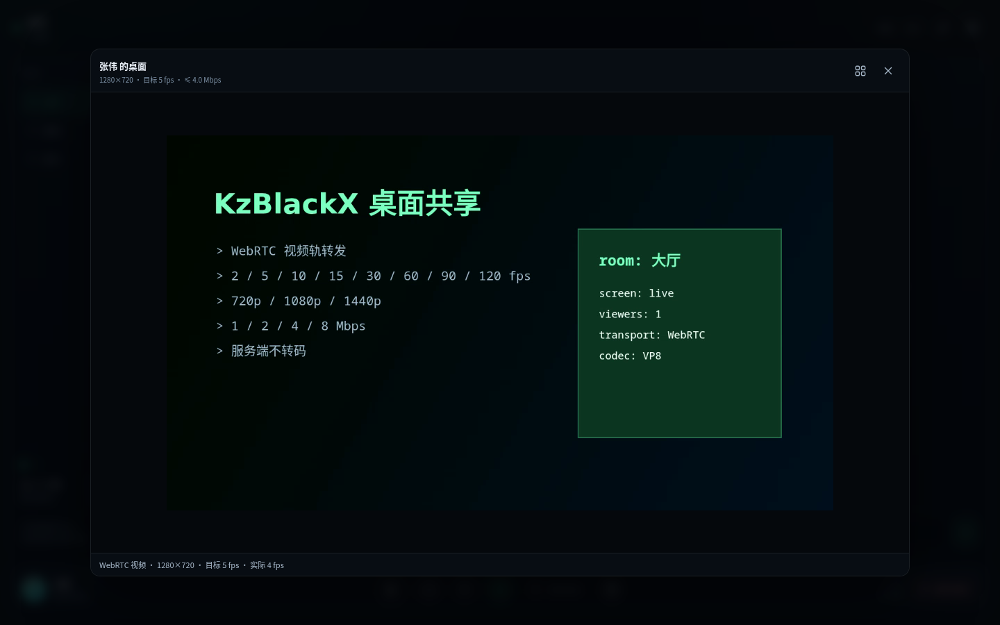
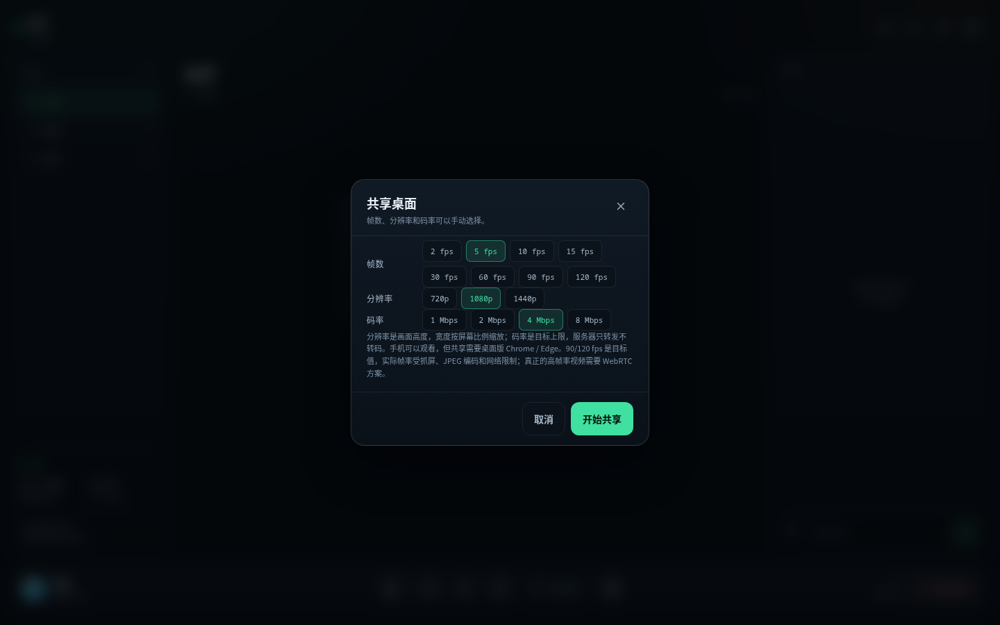
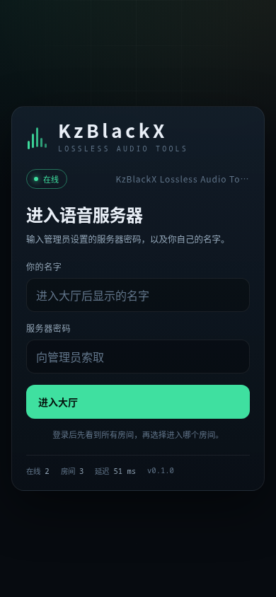
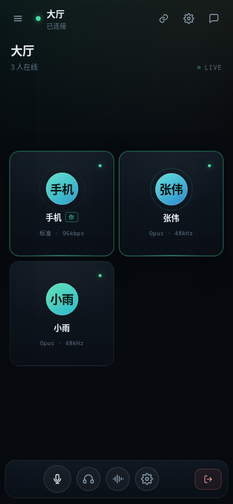

# KzBlackX Lossless Audio Tools

**KzBlackX Lossless Audio Tools**（简称 KzBlackX）——一个二进制、零转码、浏览器打开就能说的自托管语音房。

> 名字沿用你的工具集品牌。语音主通道使用 Opus 高码率编码（最高 510 kbps），属于高保真**有损**传输；另外提供一条可选的 **FLAC 无损旁路**（16-bit，约 0.8 秒延迟），用于共享音乐。

服务端只做一件事：把每个人上传的 Opus RTP 包转发给房间里其他人。它不解码、不混音、不转码、不录音，所以一台 1 GB 内存的小 VPS 也能稳稳跑起一个十几个人的语音房。

> 背景：TeamSpeak 6 beta 服务端常驻约 35 MB，Beta 许可证 32 槽位，Opus Music 质量 10 的实际上限约 **95 kbps**（客户端显示 11.87 KiB/s）。KzBlackX 把音质上限交还给 Opus 本身：实测 **320 kbps 立体声**，最高可到 510 kbps，而服务端仍然只做转发。



登录后先停在“未加入房间”的空页面，左侧列出所有房间；点一次房间会先确认，再点一次才进入：





进入后是正常的语音房间：


房间内可以发文件、共享桌面（帧数 / 分辨率 / 码率可选）：







## 特点

| | |
|---|---|
| **占用低** | 单二进制 13 MB；刚启动 RSS 约 16 MB（跑过房间后约 25 MB）；8 人 96 kbps 房间实测 32–35 MB |
| **零转码** | 服务端只转发 RTP，CPU 随“转发路数”增长，不随人数做音频运算 |
| **音质高** | Opus 48 kHz，档位 32 / 96 / 192 / 320 kbps，最高 510 kbps；支持立体声 |
| **免安装** | 电脑、手机、平板打开链接即可加入；不需要下载客户端 |
| **低延迟** | WebRTC + DTLS-SRTP；局域网/同城通常 10–40 ms RTT；服务端不做 jitter buffer |
| **回声处理** | 浏览器原生回声消除、降噪、自动增益；音乐档可关掉这些处理 |
| **登录/房间** | 管理员设置服务器密码；昵称登录后进入空房间页，第一次点房间确认、第二次进入 |
| **房间密码** | 创建房间时可选密码（bcrypt 哈希存内存）；侧边栏显示锁，进房需密码 |
| **房间/聊天** | 多房间、在线人数、文字聊天、静音、闭音、按键说话、单人音量 |
| **FLAC 无损** | 可选无损旁路，单房间同时一位发送者，适合共享音乐（约 0.8 s 延迟） |
| **文件传输** | 房间内上传文件，默认单文件 100 MB、24 小时自动清理；成员可下载，重启清空 |
| **桌面共享** | 可选 2–120 fps、720/1080/1440p、1/2/4/8 Mbps；服务端只转发 JPEG 帧，手机可观看 |
| **运维简单** | 无数据库、无 Redis、无 Node 运行时；systemd 一个服务，配置全在环境变量里 |
| **HTTPS** | 内置 Let's Encrypt（ACME），也可用现成证书或反向代理 |
| **诊断可见** | 服务端 RSS / CPU / 转发量实时显示在界面上；设置里有 RTT、抖动、丢包、码率 |

手机上的登录与房间：





## 实测数据

以下数字来自本项目测试机（x86_64，Go 1.27，Linux），用于说明量级；你的 VPS 会有所不同。

| 场景 | 服务端 RSS | 服务端 CPU | 出口流量 | 丢包 |
|---|---|---|---|---|
| 空闲（刚启动，0 人） | **16 MB** | 0% | 0 | 0 |
| 8 人，标准 96 kbps | **32–35 MB** | ≈ 34%（单核） | ≈ 5.4 Mbps | 0 |
| 2 人，录音室 320 kbps | 约 24 MB | — | ≈ 0.64 Mbps | 0 |

8 人 96 kbps 的出口流量正好是 `8 × 7 × 96 kbps ≈ 5.4 Mbps`，说明服务端确实只在转发。2 人 320 kbps 时对端 `getStats()` 实测 **321 kbps**，切到语音档后立即降到 **33 kbps**。

> CPU 的“单核百分比”指一个核心的占用。2 核 VPS 上 8 人 ≈ 整机 17%。

## 登录与房间

```
登录页（服务器密码 + 你的名字）
        ↓
未加入房间（中间空着，左侧是全部房间；不自动选大厅）
        ↓ 第一次点击房间：确认
        ↓ 第二次点击同一个房间：进入
语音房间（左侧列表可继续切换 / 创建）
```

- **服务器密码**由管理员通过 `KZBX_PASSWORD` 设置，所有用户共用；为空时不校验（会告警）。
- **昵称**由用户在登录页自己填写，不需要管理员开户。
- 登录成功后**不会自动进入大厅**，中间默认空着；左侧「房间」列表就是全部房间，点 `+` 创建新房间。
- **进入/切换房间需要点两次同一个标签**：第一次选中并提示「进入『房间名』？」，第二次才真正进入；切换时第一次点击不会打断当前房间。
- 带锁的房间显示锁图标，第二次点击会先要求输入房间密码。
- **创建房间**时可以留空密码（公开房），也可以设置密码（加密房）。密码只保存在服务端内存里（bcrypt 哈希），房间被回收后失效。
- 房间创建者不拥有特殊权限；任何登录用户都可以创建房间，受 `KZBX_MAX_ROOMS` 限制。
- 空的自建房间在 `KZBX_IDLE_ROOM_TTL`（默认 6 小时）后自动回收。
- 点「离开房间」会关闭连接、停止麦克风、FLAC、桌面共享，清空本地媒体，并回到登录页，相当于关闭软件；点击后再进来需要重新输入服务器密码。

## 文件传输

房间聊天框左下角的回形针按钮可以选择文件（支持多选）：

- 文件上传到服务端临时目录，房间内所有成员都会看到文件卡片，点一下即可下载；
- 默认单文件上限 **100 MB**，房间内共享，24 小时后自动删除；空房间回收时也会删掉文件；
- 下载链接带房间级随机 token，只对当前房间有效；
- 文件元数据只在内存里，**服务重启后文件列表和文件本身都会清空**；
- 占磁盘，不占多少内存。可以用 `KZBX_FILES_DIR`、`KZBX_MAX_FILE_MB`、`KZBX_FILE_TTL` 调整。

## 桌面共享

控制栏的显示器按钮可以共享窗口或整个桌面：

- 帧数：**2 / 5 / 10 / 15 / 30 / 60 / 90 / 120 fps**；分辨率：**720p / 1080p / 1440p**；目标码率：**1 / 2 / 4 / 8 Mbps**；
- 浏览器把画面缩放到所选高度，编码成 JPEG 帧，服务端只保留最新一帧并转发给房间成员；
- 这是 JPEG 帧转发，不是 WebRTC 视频流；**30/60/90/120 fps 是目标值**，实际帧率受抓屏、JPEG 编码和网络限制，状态栏会显示实际 fps。适合看文档、代码、演示，不适合放电影；
- 同一房间同时只能有一位共享者；观看端电脑/手机都可以，共享端需要桌面版 Chrome / Edge；
- 服务端不落盘、不转码，只占最新一帧的内存；每个观看者约消耗对应码率的带宽。

## FLAC 无损旁路

除了 Opus 语音，房间还支持一条独立的 FLAC 无损通道，适合分享音乐或做高保真监听：

- 16-bit PCM，44.1/48 kHz（跟随浏览器的 AudioContext）；
- 每 500 ms 编码成一个独立 FLAC 分片，接收端用浏览器原生 `decodeAudioData` 解码；
- 端到端延迟约 **0.8 秒**，不适合对话，适合放歌/一起听；
- 同一房间同时只允许一位发送者（服务器强制）；
- 码率取决于音乐内容，通常 **0.7–1.4 Mbps**；8 人房间约 5–10 Mbps 出口；
- 服务端只转发 FLAC 字节分片，不编码、不解码、不混音；
- 接收端不需要下载解码器（使用浏览器原生 FLAC 解码）；发送端在 Web Worker 里用 libFLAC WASM 编码。

房间底部控制栏的波形按钮即可开始/停止；房间内会显示发送者、格式、实时码率和音量。

## 音质档位

| 档位 | 码率 | 声道 | 回声消除/降噪/AGC | 适合 |
|---|---|---|---|---|
| 语音 | 32 kbps | 单声道 | 开 | 省流量、弱网 |
| 标准 | 96 kbps | 单声道 | 开 | 日常开黑（默认） |
| 音乐 | 192 kbps | 立体声 | 关 | 放歌、一起看片 |
| 录音室 | 320 kbps | 立体声 | 关 | 高保真、音乐共享 |

码率由浏览器侧 Opus 编码器执行；服务端在 SDP 里写入 `maxaveragebitrate` 并设置上限（默认 510 kbps），不参与编码。实际码率还取决于麦克风、浏览器和网络。

## 它是怎么工作的

```
   浏览器 A ── WebSocket（登录/信令/聊天）──┐
        │                                  │
        └── DTLS-SRTP / UDP 3478 ──┐       │
                                   ▼       ▼
                              ┌─────────────────┐
   浏览器 B ── UDP 3478 ─────▶ │  Go SFU（KzBlackX） │ ──▶ 浏览器 C …
        ▲                      └─────────────────┘
        └────────────── 只转发 Opus RTP，不解码 ──────────────┘
```

- 每个浏览器与服务器建立**一条** WebRTC PeerConnection：上行一路麦克风，下行 N−1 路音频。
- 服务器从每路上行读 RTP，复制给其他参与者的下行 track；SSRC/PT 由 Pion 按订阅者重写。
- 新成员加入、成员离开、切换音质时，服务器通过 WebSocket 发起 SDP 重协商。
- 没有 MCU、没有混音、没有转码，因此服务端内存与 CPU 都很平。

## 快速开始（本机试听）

```bash
# 二进制已编译好（Linux x86_64）
./dist/kzblackx-audio-linux-amd64 --addr 127.0.0.1:8080 --password test123 --rooms 大厅,游戏,音乐
```

打开 <http://127.0.0.1:8080>：

1. 输入你的名字和管理员设置的服务器密码，登录后进入空房间页；
2. 左侧「房间」列表：第一次点击确认，第二次点击进入；点 `+` 创建新房间（可设置密码）；
3. 允许麦克风后即可通话。再开一个无痕窗口用同样方式登录，就能听到自己；
4. 聊天框回形针发文件；控制栏显示器按钮共享桌面，可选 2–15 fps、720p–1440p、1–8 Mbps。

> 浏览器只在 **HTTPS** 或 **localhost** 下允许麦克风。用局域网 IP（如 `http://192.168.5.139:8080`）打开时只能“只听”或用文字聊天。手机/局域网测试请按 [局域网访问](docs/局域网访问.md) 生成证书，并用 `--addr 0.0.0.0:8443` 启动。

也可以直接用 Go 运行：

```bash
go run . --addr 127.0.0.1:8080 --password dev --rooms 大厅,游戏
```

## 部署到服务器

### 方式一：systemd + 二进制（推荐，最省资源）

```bash
# 在服务器上
sudo DOMAIN=voice.example.com ./deploy/install.sh ./dist/kzblackx-audio-linux-amd64
```

脚本会：

1. 安装 `/usr/local/bin/kzblackx-audio` 和 `kzblackx-audio.service`；
2. 创建 `kzblackx` 系统用户与 `/var/lib/kzblackx`；
3. 生成随机密码，探测公网 IP（腾讯云 metadata 优先），写入 `/etc/kzblackx/audio.env`；
4. 启动并设置开机自启，最后打印密码与访问地址。

手工部署见 [`deploy/audio.env.example`](deploy/audio.env.example) 与 [`deploy/kzblackx-audio.service`](deploy/kzblackx-audio.service)。腾讯云 + 宝塔 + 与 TS6 共存的具体步骤见 [`docs/腾讯云部署.md`](docs/腾讯云部署.md)。

### 方式二：Docker

```bash
cd deploy
cp audio.env.example audio.env   # 改密码和 KZBX_PUBLIC_IP
docker compose up -d --build
```

Compose 使用 `network_mode: host`，因为 WebRTC 的 UDP 端口必须真实直连，不能只做 HTTP 端口映射。

### 必须放行的端口

| 协议 | 端口 | 用途 |
|---|---|---|
| TCP | 443（或你自定义的 HTTPS 端口） | 页面、WebSocket 信令 |
| UDP | 3478 | 所有语音媒体（单端口多路复用） |
| TCP | 80 | 仅内置 ACME 申请证书时需要 |

云厂商安全组和主机防火墙都要放行。UDP 端口不要经过 nginx/Caddy 等 HTTP 反向代理。

### HTTPS 三种做法

1. **内置 ACME**：`KZBX_ACME_DOMAIN=voice.example.com`、`KZBX_ACME_EMAIL=you@example.com`。需要 80/443 空闲，服务会自动申请和续期。
2. **现成证书**：`KZBX_TLS_CERT=/path/fullchain.pem`、`KZBX_TLS_KEY=/path/privkey.pem`、`KZBX_ADDR=:443`。宝塔面板的证书一般在 `/www/server/panel/vhost/cert/<域名>/`。
3. **反向代理**：KzBlackX 监听 `127.0.0.1:8080`，由 nginx/Caddy 终止 TLS 并转发 WebSocket，同时设置 `KZBX_TRUST_PROXY=1`。UDP 3478 仍然直连。

nginx 片段：

```nginx
location / {
    proxy_pass http://127.0.0.1:8080;
    proxy_http_version 1.1;
    proxy_set_header Upgrade $http_upgrade;
    proxy_set_header Connection "upgrade";
    proxy_set_header Host $host;
    proxy_set_header X-Real-IP $remote_addr;
    proxy_read_timeout 3600s;
}
```

## 配置项

所有 flag 都有对应的 `KZBX_*` 环境变量，环境变量适合 systemd/Docker。

| 环境变量 | 默认 | 说明 |
|---|---|---|
| `KZBX_NAME` | `KzBlackX Lossless Audio Tools` | 服务器显示名 |
| `KZBX_PASSWORD` | 空 | 服务器登录密码；为空时任何人都能登录（会告警） |
| `KZBX_PUBLIC_IP` | 空 | **云服务器必填**，用于 NAT 后的 ICE 候选地址 |
| `KZBX_UDP_PORT` | `3478` | 媒体端口（单端口复用） |
| `KZBX_ROOMS` | `大厅,游戏,音乐` | 常驻房间，逗号分隔 |
| `KZBX_MAX_ROOM` | `16` | 单房间人数上限 |
| `KZBX_MAX_ROOMS` | `32` | 房间数量上限 |
| `KZBX_MAX_BITRATE` | `510` | Opus 码率硬上限（kbps） |
| `KZBX_IDLE_ROOM_TTL` | `6h` | 空的自建房间多久后回收 |
| `KZBX_FILES_DIR` | `./data/files` | 房间文件临时目录（systemd 安装为 `/var/lib/kzblackx/files`） |
| `KZBX_MAX_FILE_MB` | `100` | 单文件上限（MiB） |
| `KZBX_FILE_TTL` | `24h` | 上传文件保留时间 |
| `KZBX_ADDR` | `:8080` | HTTP 监听地址（ACME 模式下忽略） |
| `KZBX_TLS_CERT` / `KZBX_TLS_KEY` | 空 | 证书路径 |
| `KZBX_ACME_DOMAIN` / `KZBX_ACME_EMAIL` | 空 | 自动 HTTPS |
| `KZBX_TRUST_PROXY` | `0` | 信任 `X-Forwarded-For`（反向代理时设 1） |
| `KZBX_LOG_LEVEL` | `info` | `debug` / `info` / `warn` / `error` |

命令行对应写法：`--name`、`--password`、`--public-ip`、`--udp-port`、`--rooms`、`--max-room`、`--max-rooms`、`--max-bitrate`、`--idle-room-ttl`、`--files-dir`、`--max-file-mb`、`--file-ttl`、`--addr`、`--tls-cert`、`--tls-key`、`--acme`、`--acme-email`、`--trust-proxy`、`--log-level`。`--help` 查看全部。

### 公网 IP / NAT

腾讯云、AWS 等 VPS 的网卡地址通常是内网地址（如 `10.0.0.4`），公网 IP 做 1:1 NAT。必须设置 `KZBX_PUBLIC_IP=124.220.202.166`，否则浏览器会拿到不可达的 ICE 候选，表现为“已连接但听不到声音”。

服务端不需要 STUN/TURN：浏览器会主动向服务器的公网 UDP 端口发连通性检查，服务器从对端反射地址回包即可建立通路。

## 运维

```bash
systemctl status kzblackx-audio
journalctl -u kzblackx-audio -f
curl -s https://voice.example.com/healthz
curl -s https://voice.example.com/api/info | python3 -m json.tool | head -40
```

- 升级：替换二进制后 `systemctl restart kzblackx-audio`；无状态，无需迁移数据。
- 备份：没有数据库。需要保留的只有 `/etc/kzblackx/audio.env` 和 ACME 证书缓存。
- 观察：界面左下角实时显示服务端 RSS / CPU；`/healthz` 返回在线人数和运行时长。
- 扩容：单房间 N 人的出口带宽约为 `N × (N−1) × 码率`；16 人 96 kbps ≈ 23 Mbps，16 人 320 kbps ≈ 72 Mbps。200 Mbps 带宽足够，但要注意按流量计费。

### 容量建议（2 核 1 GB）

| 场景 | 建议 |
|---|---|
| 日常 8–12 人语音（96 kbps） | 很轻松，CPU 约 20–35% 单核 |
| 16 人同时说话（96 kbps） | 可行，建议实测出口带宽与 CPU |
| 8 人音乐档（320 kbps） | 可行，出口约 18 Mbps |
| 20+ 人高码率 | 建议升配或限制音质档位 |

## 浏览器支持

| 浏览器 | 支持 |
|---|---|
| Chrome / Edge 90+ | ✅ 完整 |
| Firefox 90+ | ✅ 完整（立体声/AGC 行为随版本略有差异） |
| Safari 15.4+（macOS/iOS） | ✅ 基本可用；iOS 切后台会暂停麦克风 |
| 微信内置浏览器 | ⚠️ 不保证，建议用系统浏览器打开 |

麦克风需要安全上下文（HTTPS 或 localhost）。页面必须保持在前台才能按键说话；这是浏览器限制，不是服务端限制。

Windows 会把同一个麦克风同时暴露成“默认 / 通讯 / 原始”三个端点；设置里的设备列表会自动合并成一项，并去掉 `(0a67:d172)` 这类硬件 ID 后缀。

## 已知限制

- **桌面共享是 JPEG 帧转发**：可选 2–120 fps 目标值，但不是 WebRTC 视频；高帧率受抓屏、编码和网络限制，状态栏显示实际值。
- **文件不持久**：文件只存在服务端临时目录，默认 24 小时或服务重启后清空；没有权限组、频道树。
- **按键说话只在前台生效**：浏览器无法捕获全局热键。游戏时可以把页面放副屏，或用“麦克风常开”。
- **iOS 锁屏/切后台会中断**：WebRTC 在移动端的系统限制。
- **不是端到端加密**：浏览器到服务器是 DTLS-SRTP 加密，服务器能看到（但不解码）音频包。需要 E2EE 请另选方案。
- **服务端无持久化**：聊天记录、房间密码只存在内存，重启即清空；房间被回收后密码也失效。
- **FLAC 只支持一位发送者**：同一房间同时只能有一条无损流；延迟约 0.8 秒，不适合语音对话。
- **房间密码只在创建时设置**：暂不支持给已存在的房间改密码。
- **单人上行带宽 = N−1 份下行**：这是 SFU 的固有代价；1 个人说话时其他人只收 1 路，不会叠加。

## 与 TeamSpeak 6 beta 的取舍

| | TeamSpeak 6 beta | KzBlackX |
|---|---|---|
| 服务端 | 官方闭源，约 35 MB | 单二进制，16 MB 空闲 |
| 客户端 | 官方客户端 | 浏览器，免安装 |
| 音质上限 | Opus Music ≈ 95 kbps | 实测 320 kbps，上限 510 kbps |
| 许可 | 32 槽位 Beta | 无 |
| 视频/屏幕共享 | Beta 中未实现 | 桌面共享（2–120 fps 目标，JPEG 帧） |
| 文件传输 | 支持 | 支持（房间临时存储，默认 100 MB / 24h） |
| FLAC 无损旁路 | 不支持 | 支持（单发送者） |
| 权限/频道管理 | 完整 | 无 |
| 部署 | Docker | 单二进制 / systemd / Docker |

KzBlackX 不是要替代 TS6 的全部功能，而是把“低占用 + 高音质 + 朋友点链接就能进”这三件事做到极致。需要权限体系和成熟客户端时，TS6 仍然更合适。

## 开发与测试

```bash
# 单元测试（SDP、配置解析）
go test ./...

# 端到端：两个无头 Chromium 互相说话、聊天、静音
cd test
npm install
npx playwright install chromium
QY_BASE=http://127.0.0.1:8080 QY_PASSWORD=test123 node e2e.mjs
```

端到端测试会：

1. 用 Chromium 的虚拟麦克风加入两个客户端；
2. 断言双方都收到对方的音频（`inbound-rtp` 字节数增长、音频元素可播放）；
3. 断言聊天到达对端；
4. 静音后断言对端音量归零；
5. 关掉一方，断言另一方收到 `peer-left`。

### 目录结构

```
.
├── main.go / config.go        # 入口与配置
├── hub.go / peer.go           # 房间、成员、信令
├── rtc.go                     # SFU：转发、重协商、SDP 参数
├── ws.go / protocol.go        # WebSocket 协议
├── stats.go / web.go          # 运行指标、HTTP 与内嵌前端
├── web/                       # 浏览器客户端（无构建步骤）
├── deploy/                    # systemd、安装脚本、Docker
├── docs/                      # 部署指南与截图
└── test/                      # Playwright 端到端测试
```

## 安全建议

- 一定设置 `KZBX_PASSWORD`，并使用 HTTPS。
- 只放行必要端口；UDP 3478 对公网开放是设计使然。
- 不要把管理面板、SSH 和 KzBlackX 混在同一个弱口令环境里。
- 服务端不落盘音频；但 DTLS-SRTP 只保证传输加密，不保证服务器不可见。
- 如担心滥用，可在前面加一层 nginx 限速/鉴权，或使用云防火墙限制来源。

## License

MIT
